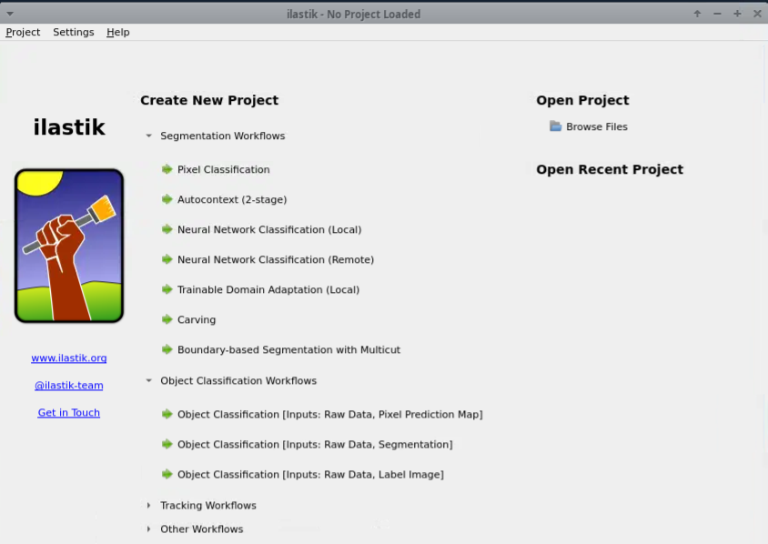
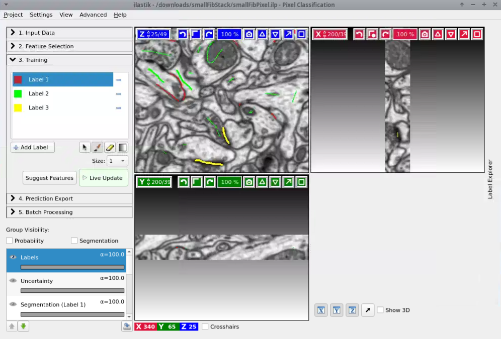

# ilastik
## Introduction
ilastik is a user-friendly tool for interactive image classification,
segmentation and analysis. It is designed for use by people without machine
learning expertise. It is developed by the ilastik team in Anna Kreshuk's lab at
the European Molecular Biology Laboratory. You can find out more about the
project and using ilastik on the official [documentation
pages](https://www.ilastik.org/documentation/).

## Using ilastik
**Prerequisites**:
ilastik may be run without a GPU, using the `-cpu` tagged container images. To
run workflows that use deep neural networks, you will need an NVIDIA graphics
card and the `-gpu` container images.

### Running the Container
The latest CPU-only build of the ilastik container can be run either using Apptainer:
```bash
apptainer run docker://quay.io/ccp-volume-em/ilastik:latest
```
Or with Docker:
```bash
docker run \
    -v /path/to/data:/data \
    -e DISPLAY=$DISPLAY \
    -v /tmp/.X11-unix:/tmp/.X11-unix \
    quay.io/ccp-volume-em/ilastik:latest
```
To instead launch a GPU-enabled build, find the latest version with the `-gpu` tag
[here](https://quay.io/repository/ccp-volume-em/ilastik?tab=tags) and
run
```bash
apptainer run --nv docker://quay.io/ccp-volume-em/ilastik:<version>-gpu
```
or
```bash
docker run \
  --gpus all \
  -v /path/to/data:/data \
  -e DISPLAY=$DISPLAY \
  -v /tmp/.X11-unix:/tmp/.X11-unix \
  --device=/dev/dri:/dev/dri \
    quay.io/ccp-volume-em/ilastik:<version>-gpu
```

Note that with Docker the volume (`-v`) mount is necessary to provide access to
your image data, as well as a persistent save location for your ilastik
projects. Apptainer provides access to your current working directory and
`/home/$USER`; additional locations can be added with
`--bind /path/to/data:/data`. On remote displays, it may be necessary to enable
non-local connections via `xhost +` or give access to the host network.

### Running a workflow

On starting ilastik you see the default *No Project Loaded* menu. If you have
previously started and saved a project with ilastik, you can load it under
*Open Recent Project* or by browsing for a `.lip` file under *Open Project >
Browse Files*. Otherwise you will need to select a target workflow to begin.
When prompted, make sure you choose a save location for your project that is
accessible outside the container (either in the current directory or
`/home/$USER` for Apptainer, or any directory you explicitly mounted
with `docker -v`).


*The starting No Project Loaded menu of ilastik*

After selecting a workflow for a new project or loading an existing project, you
will be taken to a workflow-specific pane where you can load images from disk
(e.g. `.tiff`, `.h5`) and execute workflow steps against the image. Note that
in general ilastik will only work on the parts of the image in the current
viewport; if you want to analyse the entire image make sure you zoom out using
the triangle 'Zoom to fit' button.


*Example Pixel Classification Project courtesy of Graham Knott & EPF Lausanne*

To help get started, you might want to download and run some of the example
projects from [ilastik.org/download](https://www.ilastik.org/download).

## Troubleshooting and Support
### Getting help
If you encounter problems using the container, you can [create an
issue](https://github.com/ccp-volume-em/ilastik/issues/new) on the GitHub
repository. Please share as much information as you can regarding any crash, for
example your host system (e.g., Nvidia card and driver, operating system and
container runtime), the commands you are trying to run as well as any error
messages.

## License information
ilastik and the container image are released under GPL licenses. If you use the
GPU-enabled builds, you also accept the terms and conditions of the CUDA EULA.

If you use ilastik in your work, consider citing the Nature Methods
Perspective[^1] for the current (1.0+) ilastik project. A full list of relevant
publications is available [here](https://www.ilastik.org/publications).

[^1]: Stuart Berg et al., [Nature Methods 16, 1226-1232 (2019)](https://www.nature.com/articles/s41592-019-0582-9)

## 🔗 Useful Links

- [container image repository](https://github.com/ccp-volume-em/ilastik)
- [ilastik project repository](https://github.com/ilastik/ilastik)
- [ilastik documentation and tutorials](https://www.ilastik.org/documentation/)
- [ilastik publications](https://www.ilastik.org/publications)
